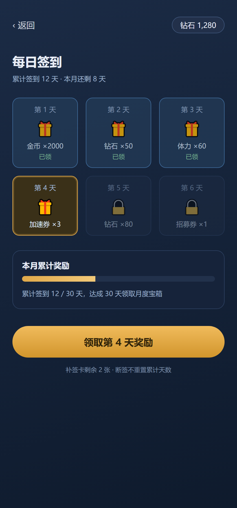

本页是 sr-gdd-html 的<b>合成形态基准</b>，不是任何真实功能的规则。它演示两件事：定稿 §1–§11 怎么落到面板上，以及每一节该用哪个组件。真实页面的内容全部来自源定稿，一个数都不许改。

## §1 功能意图

### 一句话功能

玩家每天进入签到面板领取当日奖励。连续签到累积进度，断签不清空本月累计天数。

### 为什么要做

旧的签到入口埋在活动页里，玩家找不到。本次把入口提到主城 HUD，并把"断签不清零"写进界面。

### 本功能不解决什么

| 不解决项 | 原因 |
| --- | --- |
| no 付费签到产品（月卡 / 周卡） | 属于商业化线，另立功能 |
| no 签到历史详情页 | 本轮不做，列进"不做" |
| no 奖励内容的投放渠道调整 | 由运营侧另行发起 |

## §2 玩家动词

| 动词类型 | 玩家动作 |
| --- | --- |
| 直接动作 | 点击签到底部的领取按钮 |
| 养成动作 | 用补签卡补领错过的日期 |
| 脑内判断 | 判断今天要不要用补签卡 |
| 重复行为 | 每天登录后先领签到奖励 |

## §3 核心循环

### 即时循环

```flow LR
(User) -> 点击领取: 打开面板
点击领取 -> 面板刷新: 发放成功
面板刷新 -> User: 看到已领态与新进度
```

### 长期循环

```flow LR
每日签到 -> 累计天数: 逐日累加
累计天数 -> 月度宝箱: 达成目标
月度宝箱 -> 每日签到: 新目标驱动次日登录
```

## §4.1 R1 签到与累计

| 规则 | 细节 | 配置字段 |
| --- | --- | --- |
| 每日一次 | 每个自然日只可领取一次，按服务器时间跨天重置 | `SignIn.DailyLimit` |
| 累计天数 | 本月内已签到的总天数，跨月重置 | `SignIn.MonthTotal` |
| 断签口径 | 断签不重置累计天数，只影响连续签到计数 | `SignIn.StreakReset` |

## §4.2 R2 补签

| 规则 | 细节 | 配置字段 |
| --- | --- | --- |
| 触发条件 | 存在可补领的日期，且玩家持有补签卡 | `Item.MakeupCard` |
| 消耗 | 每次补签消耗补签卡 1 张（参考值，待定） | `SignIn.MakeupCost` |
| 边界 | 当月最后一天结束后关闭补签入口 | 待配表 |

## §5.0 界面清单

| 界面ID | 名称 | 进入方式 | 退出方式 |
| --- | --- | --- | --- |
| UI-M1 | 每日签到面板 | 主城 HUD 入口 | 返回键 |
| UI-M2 | 签到成功弹窗 | 面板主按钮 | 确认按钮 / 点击空白处 |

## §5.1 UI-M1 每日签到面板



| 编号 | 规则（详细） |
| --- | --- |
| UE1 | 顶部栏：返回按钮 + 当前货币余额；返回时回到进入前的位置，不重置主城列表滚动 |
| UE2 | 标题区：显示「每日签到」与副标题「累计签到 N 天 · 本月还剩 M 天」，N、M 随状态实时刷新 |
| UE3 | 奖励格子按日期顺序排列，每格显示日期、奖励图标与数量 |
| UE4 | 奖励格子三态：已领（打勾并置灰）、今日可领（高亮描边并默认聚焦）、未达成（锁定并降低透明度） |
| UE5 | 已领格子不可点击：点它不弹提示、也不发请求 |
| UE6 | 本月累计奖励区：进度条显示「累计 N / 目标 天」 |
| UE7 | 累计达成后该区切换为可领取态，并出现领取入口 |
| UE8 | 主按钮可领态显示「领取第 N 天奖励」 |
| UE9 | 主按钮已领态置灰并显示「今日已领取」 |
| UE10 | 主按钮在请求处理中置灰，并拦截重复点击 |
| UE11 | 底部提示显示补签卡剩余数量 |
| UE12 | 底部提示显示「断签不重置累计天数」的口径说明 |
| UE13 | 补签入口在存在可补领日期且持有补签卡时出现，并显示可用数量 |
| UE14 | 补签卡不足时补签入口置灰，点击给出获得途径提示 |
| UE15 | 拉取失败时面板显示重试入口，不展示上一轮缓存数据 |
| UE16 | 重试成功后整区刷新，格子状态、累计进度与红点同步更新 |

## §5.2 UI-M2 签到成功弹窗

定稿只给了 ASCII 线框图，页面按原样保留：

```text
┌──────────────────────────┐
│        签到成功          │
├──────────────────────────┤
│  [金币 2000]  [钻石 50]  │
│  连续签到 6 天 · 下次 +20 │
│      ┌──────────┐        │
│      │  开心收下 │        │
│      └──────────┘        │
└──────────────────────────┘
```

| 编号 | 规则（详细） |
| --- | --- |
| UE1 | 蒙层拦截穿透点击；点击空白处关闭 |
| UE2 | 奖励清单按配置顺序逐项列出，不合并同类项 |
| UE3 | 弹窗未关闭期间，底层面板的主按钮不可点 |

## §5 界面流程

```flow LR
(主城入口) -> [每日签到面板]
[每日签到面板] -> [签到成功弹窗]: 点击主按钮
[签到成功弹窗] -> [每日签到面板]: 确认或点空白处
[每日签到面板] -> (返回键): 退出
```

## §6 配置契约

### §6.1 签到功能配置.xlsx（本功能配置工作簿）

| 中文表名 | 输出文件名 / 映射名 | 索引 | 状态 |
| --- | --- | --- | --- |
| 签到主表 | `SignIn` / `sign_in` | 1 | warn 新增 |
| 月度宝箱表 | `SignInChest` / `sign_in_chest` | 1 | warn 新增命名待定 |

**签到主表**（`sign_in`）—— 每个自然日一行

| 中文字段 | 英文字段 | 数据结构 | 含义 |
| --- | --- | --- | --- |
| 日期序号 | DayIndex | int | 本月第几天，从 1 起 |
| 奖励道具 | RewardItem | int | 引用 `Item.ItemId` |
| 奖励数量 | RewardCount | int | 该道具的发放数量 |
| 是否大奖 | IsBigReward | int | 1 = 月度宝箱节点 |

```callout info 依赖的外部表
本功能读取 `Item` 与 `GlobalVar` 两张既有表，只读不改。
```

## §7 多语言文本

| 键 | 中文文案 | 状态 |
| --- | --- | --- |
| sign_in_title | 每日签到 | warn 新增 |
| sign_in_sub | 累计签到 {0} 天 · 本月还剩 {1} 天 | warn 新增 |
| sign_in_btn_claim | 领取第 {0} 天奖励 | warn 新增 |
| sign_in_btn_done | 今日已领取 | ok 已有 |
| sign_in_makeup_tip | 断签不重置累计天数 | warn 新增 |

## §8 范围门

| 范围层级 | 纳入 | 排除 |
| --- | --- | --- |
| 最小可行版本 | ok 面板 / 当日领取 / 成功弹窗 / 累计进度 | — |
| 垂直切片 | ok 补签 / 月度宝箱 / 跨月重置 | — |
| 不做 | — | no 付费签到产品 / 社交分享 / 签到历史页 |

## §9 数据埋点信号

| 信号 | 用途 |
| --- | --- |
| sign_in_panel_open | 统计入口曝光与打开率 |
| sign_in_claim | 统计领取成功率与失败原因 |
| sign_in_makeup | 统计补签卡消耗 |

## §10 验收标准

| 编号 | 标准 | 优先级 |
| --- | --- | --- |
| AC1 | 跨天后可再次领取，同一自然日内重复点击不重复发放 | P0 |
| AC2 | 断签不清空本月累计天数，界面计数与服务器一致 | P0 |
| AC3 | 补签卡不足时入口置灰，点击给出获得途径提示 | P1 |
| AC4 | 全部文案走多语言键，切换语言后界面无残留中文 | P1 |

## §11 交接清单

| 角色 | 需要内容 | 负责人 |
| --- | --- | --- |
| 服务端程序 | 签到状态、累计天数与补签的接口约定 | 待定 |
| UI 程序 | 面板与弹窗的预制体改造 | 待定 |
| UI/UX | 面板与弹窗的最终视觉稿 | 待定 |
| 测试 | §10 的验收标准与跨天 / 跨月边界用例 | 待定 |
